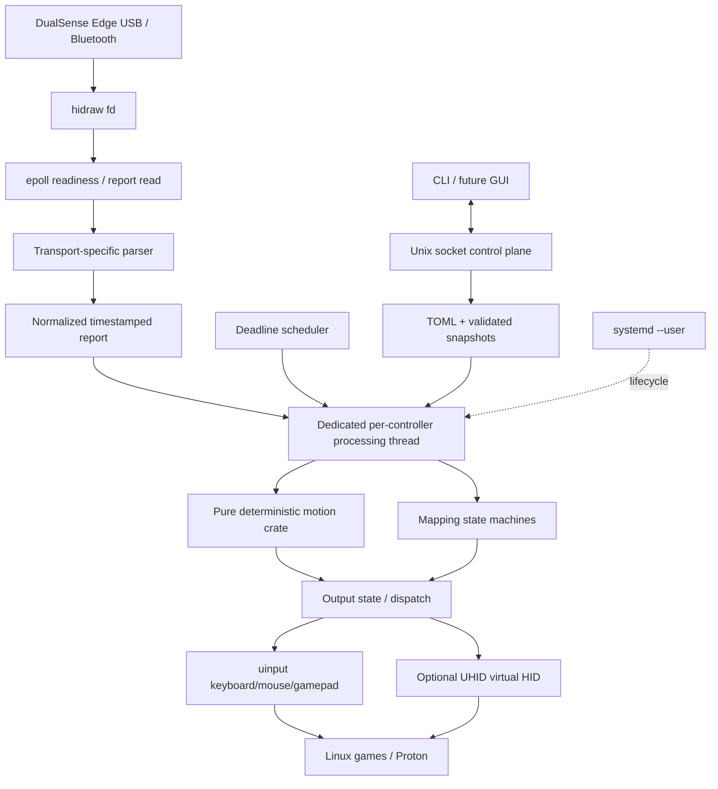

# Architecture and flow

## Threads and scheduling
Start with one processing thread per controller. It owns the parser, mapping and motion state, and preferably submits output directly. A control-plane thread owns IPC, configuration persistence and diagnostics. Timer deadlines are integrated into the same processing event loop; don't spin when idle. A read-ready event may contain multiple reports: drain until EAGAIN, preserving order. Bound the amount of work per wakeup to avoid starvation; benchmark any batching.

## Suggested workspace (adjust only with evidence)
- `joyshockrust-core`: normalized types, controller state and orchestration.
- `joyshockrust-input`: hidraw transport, discovery, device-specific parsers.
- `joyshockrust-motion`: pure deterministic calibration, fusion and gyro mapping math.
- `joyshockrust-mapping`: buttons, triggers, sticks and deadline-driven actions.
- `joyshockrust-output`: output traits and state diffing.
- `joyshockrust-linux`: uinput/UHID, udev, fd/event-loop helpers.
- `joyshockrust-config`: TOML, validation, migration and persistence.
- `joyshockrust-ipc`: versioned Unix socket protocol.
- `joyshockrust-daemon`: lifecycle and orchestration.
- `joyshockrust-cli`: inspection and commands.

Do not create all crates prematurely; a few coherent crates are better than artificial boundaries. GUI is a separate future client of IPC.

## Key invariants
- One owner of each controller's mutable runtime state.
- No mutex shared with IPC in the per-report path.
- Input samples are timestamped and ordered; output changes are explicit.
- Physical transport, normalization, motion, mapping and output are separately testable.
- On disconnect: release active virtual inputs and close resources deterministically.
- Virtual devices must not be rediscovered as physical inputs.
