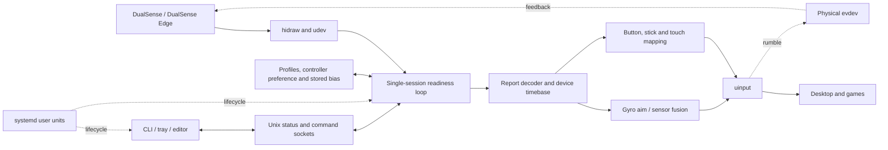

# Architecture and flow

The Linux bridge owns one active DualSense or DualSense Edge session over
USB or Bluetooth. The GTK editor and system tray run as separate processes.
The bridge can also run from the CLI or as a user service without the tray.

## Runtime and scheduling

The bridge waits with `poll` on hidraw, IPC and optional force-feedback
descriptors. Udev discovery waits for hotplug when no eligible controller
is open. Readable hidraw reports are decoded in order in bounded
nonblocking batches. The next keyboard gesture deadline is part of the
same wait. Status requests can be served between full batches. This keeps
device reads, configuration changes and output state on one owner.
[Report loop](crates/joyshockrust-linux/src/main.rs) · [Wait and reload](crates/joyshockrust-linux/src/reload.rs)

The logical control plane uses local Unix sockets. There is no separate
IPC thread for the bridge's command and status loop. Controller selection,
mapping profile and calibration are stored separately. Session setup can
open device handles and read settings. Calibration persistence and PCM
haptics use worker paths when needed. The steady-state report path avoids
filesystem work, blocking IPC and shared configuration locks.
[Discovery](crates/joyshockrust-linux/src/discovery.rs) · [Calibration storage](crates/joyshockrust-linux/src/gyro_calibration.rs) · [Haptics](crates/joyshockrust-linux/src/haptics.rs)

The tray starts and stops the user service and uses XDG autostart for its
login preference. The editor retains its TOML draft and uses the bridge
CLI for full validation. Desktop control commands and CLI commands use the
same Unix-socket client for profile activation and emulation changes.
The bridge exposes calibrated IMU and preview readings through its status
socket. The Gyro tab reads both gyro fields from the same reply. The
Flick Stick preview reads the selected hidraw node while visible.
Desktop refresh timers are independent of bridge report timing.
[Desktop lifecycle](DECISIONS.md#desktop-process-lifecycle) · [Live IMU](crates/joyshockrust-editor/src/imu_monitor.rs) · [Stick preview](crates/joyshockrust-editor/src/flick_preview.rs)

## Workspace

| Crate | Responsibility |
|---|---|
| `joyshockrust-core` | Transport-neutral controller state, canonical input names, analog trigger gates and touch-grid geometry. |
| `joyshockrust-config` | Raw common profile schema, profile version, trigger compatibility rules and desktop paths. |
| `joyshockrust-input` | USB and Bluetooth parsing, factory conversion and device timebase. |
| `joyshockrust-ipc` | Local status fields, typed telemetry and control codecs, and a Linux command client. |
| `joyshockrust-motion` | Deterministic calibration, gyro and fusion aim, Flick Stick composition, integer pointer motion and stick response. |
| `joyshockrust-mapping` | Gamepad, keyboard and mouse routing, gesture deadlines, gyro activation, touch regions, layers and trigger stages. |
| `joyshockrust-linux` | CLI, udev/hidraw, session lifecycle, device-dependent profile compilation, socket servicing, evdev key resolution, uinput event encoding and feedback. |
| `joyshockrust-tray` | StatusNotifierItem, desktop lifecycle and calibration launch. |
| `joyshockrust-editor` | GTK 4/libadwaita profile editing with `toml_edit`, live charts and Wayland calibration windows. |

Applications use shared codecs at the control boundary. The bridge
validates profile input before installing runtime state. HID report
processing uses resolved gates, settings and bitsets.

## Key invariants

- Keep transport decoding, normalized controls, motion, mappings and output independently testable.
- Preserve decoded report order. Handle repeated sensor timestamps, resets, gaps and wraparound explicitly.
- Release held virtual inputs on disconnect or controller switch and close old devices before opening replacements.
- Keep controller selection independent of the active profile. A session uses one physical controller.
- Keep the virtual devices outside physical discovery. Apply game visibility policies separately from the input loop.
