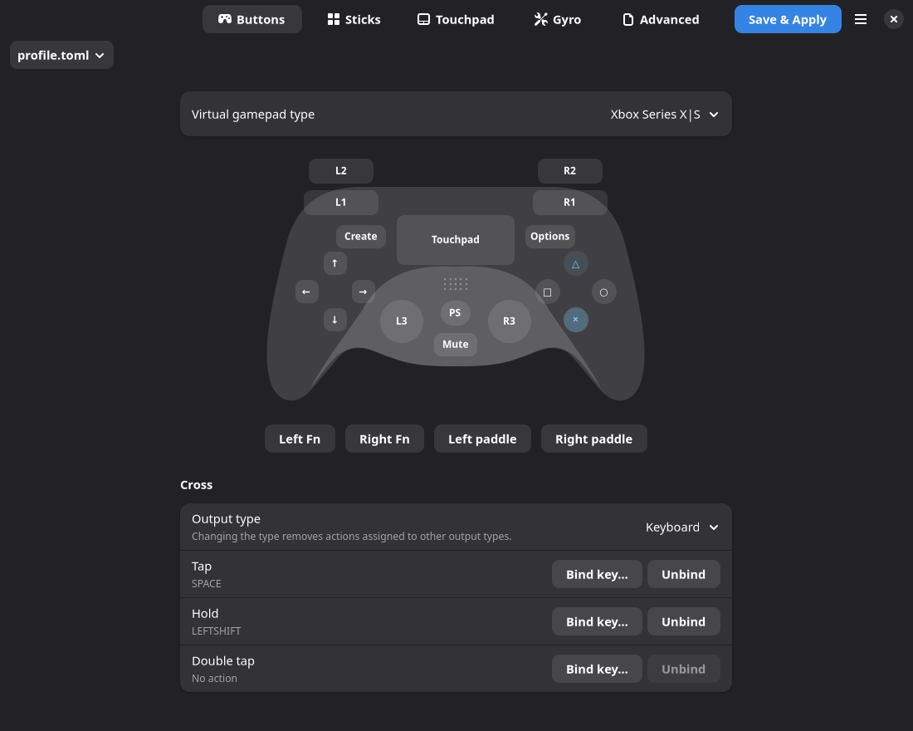
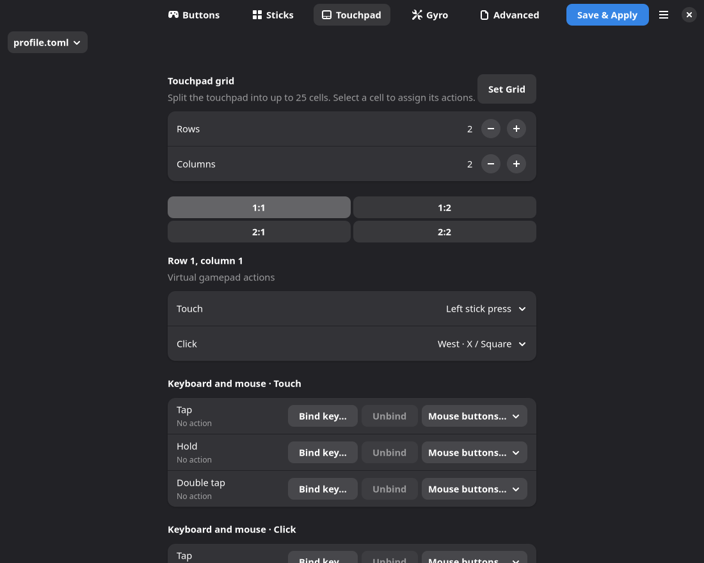
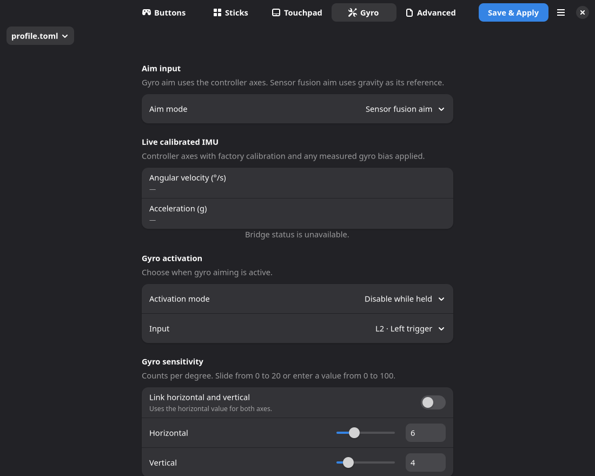
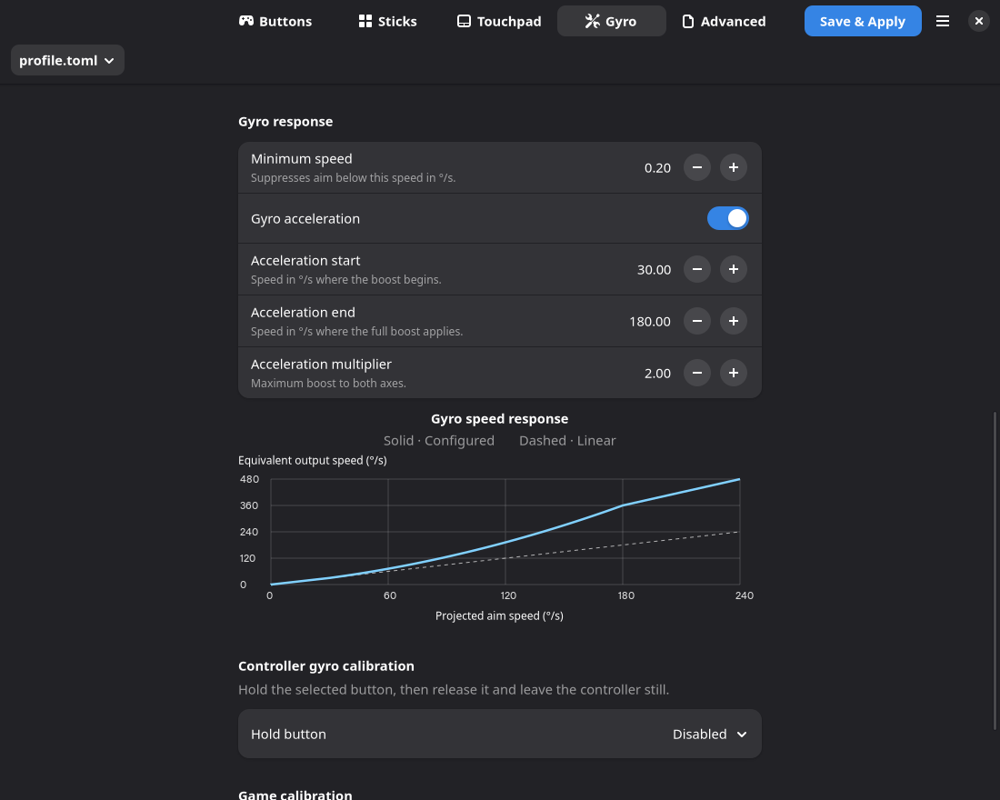

# Profile editor screenshots

These screenshots show the GTK 4 and libadwaita profile editor running on
Wayland in dark mode with an example profile. The editor was captured with no
physical controller connected, so the live input and IMU previews are idle.

## Buttons

Select a physical control on the DualSense layout to edit its bindings. This
profile maps Cross to Space on tap and Left Shift on hold.

## Sticks

Choose a stick mode and compare the physical and mapped input previews.
The right stick in this example uses Flick Stick.

## Touchpad

Choose a grid region to configure separate touch and click actions.

## Gyro

Choose the aim mode and activation, view the calibrated IMU readings, and
adjust horizontal and vertical sensitivity.

## Gyro response

Compare the configured acceleration curve with the linear response while
adjusting the acceleration settings.

## Advanced TOML

Open **Advanced** to edit the profile directly in TOML.

