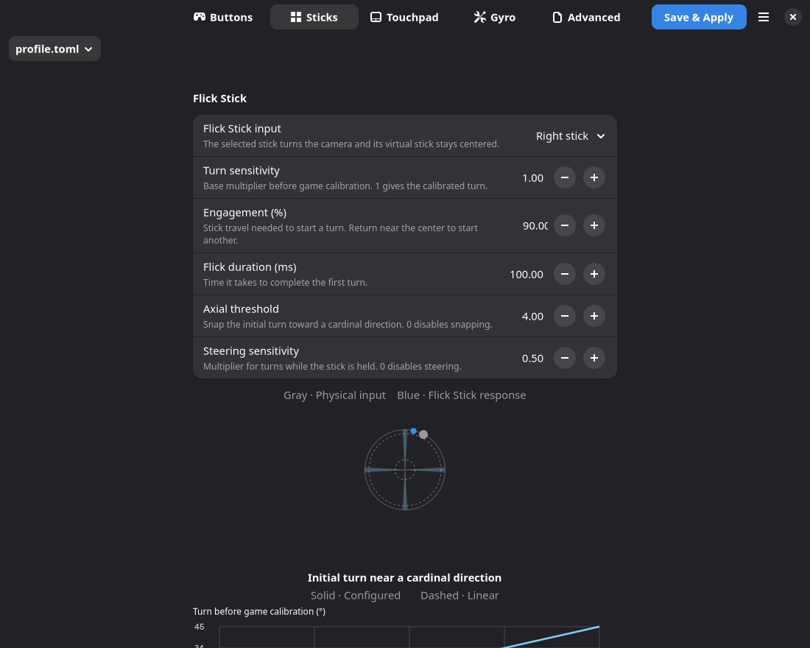
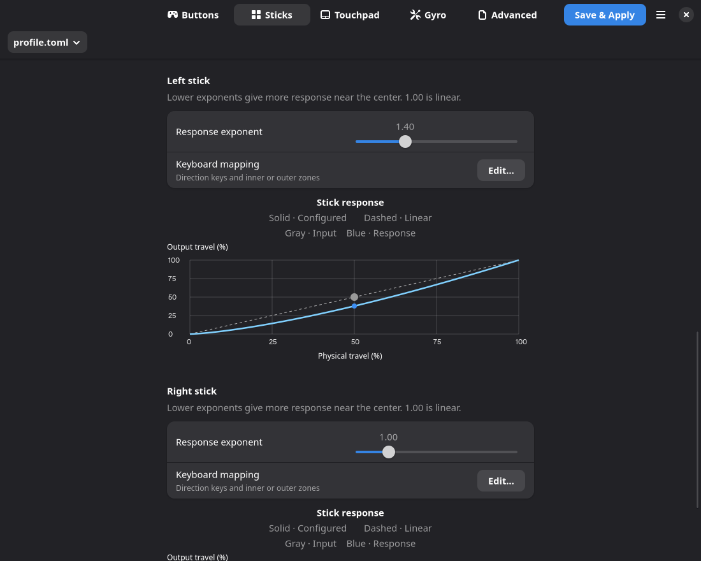
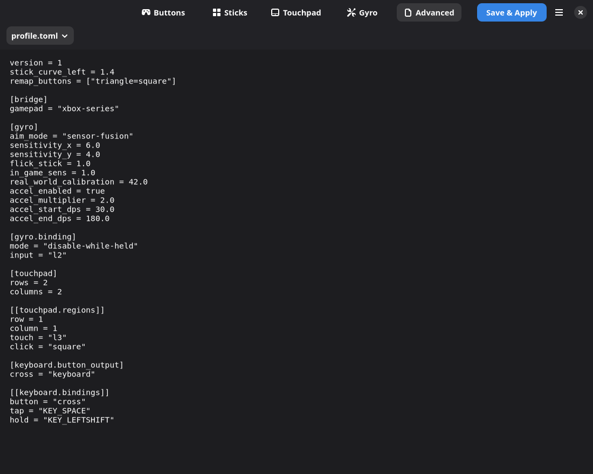

# Profile editor screenshots

These screenshots show the GTK 4 and libadwaita profile editor running on
Wayland in dark mode with an example profile. The live previews use
synthetic controller readings.

## Buttons

Select a physical control to edit its bindings. This profile maps Cross
to Space on tap and Left Shift on hold. [DualSense SVG](../crates/joyshockrust-editor/assets/dualsense.svg)

## Sticks

Choose a stick mode and compare the gray physical input with the blue
response. The right stick in this example uses Flick Stick.

## Touchpad

Choose a grid region to configure separate touch and click actions. The
preview uses the upper half of the same DualSense SVG, highlights the selected
region on the touchpad, and shows each finger as a dot. Changing the
number of rows or columns updates the grid immediately.

## Gyro

Choose the aim mode and activation, view the calibrated IMU readings, and
adjust horizontal and vertical sensitivity. The three angular velocity
sliders show signed movement with zero at the center.

## Gyro response

Compare the live input speed with the response under the selected
threshold and acceleration settings.

## Advanced TOML

Open **Advanced** to edit the profile directly in TOML.

